# Claim Earth: Simulating, Rendering, and Colliding with a Texture

In Claim Earth, opening a passage can do much more than make room for the
player. Sand falls into the gap. Water finds a new route, reaches lava, and becomes
steam. The steam collects under a ceiling while the lava starts forming a stone
crust. Nearby sulfur can turn a flooded pocket into acid or begin releasing
poisonous gas.

These interactions all operate on a hexagonal world stored as a texture. GPU
render passes advance the terrain, a presentation shader draws the cave, and custom
collision code lets the player stand on the resulting cells. There is no
terrain mesh to rebuild when a bomb changes the map, and no terrain collider mesh to
regenerate.

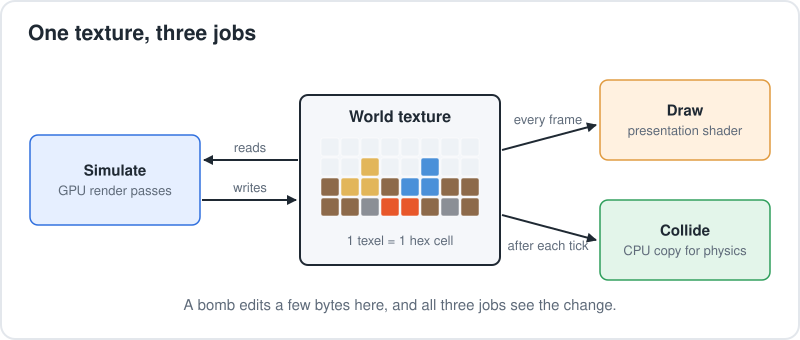

Here is how those pieces fit together in Godot's Compatibility renderer, with a
single-threaded Web export as the baseline.

## Four bytes per hex

The default world is 100 columns wide and 512 rows deep: 51,200 hex cells. Its
simulation texture has the same dimensions. One texel represents one cell,
regardless of how many screen pixels that hex occupies.

The texture uses RGBA8, giving each cell four bytes. Those channels contain data
rather than display colors.

- `R`: Two material IDs, packed into four bits each.
- `G`: Primary material quantity.
- `B`: Lighting.
- `A`: Secondary material quantity.

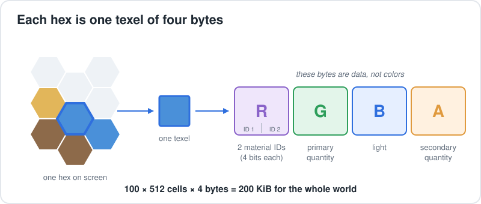

That makes one raw world snapshot 200 KiB. Intermediate render targets, material
artwork, and other lookup textures are additional allocations.

The primary material is the cell's visible material and the one gameplay queries
use. The secondary material holds displaced content that still exists in the
simulation. Each component has its own quantity.

For sand, water, and lava, 127 quantity represents visible fullness. Higher
values, up to 255, store overpressure without making the hex look larger. Gases have
their own normal pressure values: air uses 64, for example. This gives the
simulation room to compress material when it cannot immediately escape.

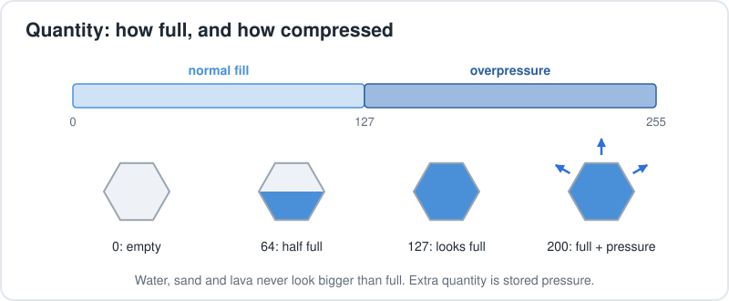

## Simulating terrain with render passes

The terrain simulation is a cellular automaton: each update applies local rules
to cells and their neighbors. Gravity, flow, displacement, and contact reactions
combine to produce the larger movement visible in the cave.

The GPU runs those rules through a fragment shader. A pass samples the previous
state texture and writes the next state into a render target. Godot SubViewports
provide those targets, so the implementation uses ordinary raster rendering
without requiring a compute shader.

The difficult part is deciding who may transfer material where. If every cell
independently pushes water into its neighbors, several cells can claim the same
destination capacity. The simulation instead divides connections into independent
pairs for each pass. Each fragment resolves its pair from the same two source
cells and writes its own cell's result.

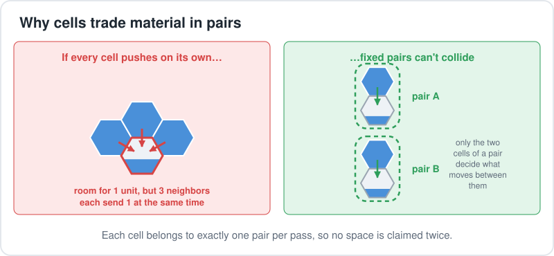

A complete tick contains six ordered passes:

1. Vertical even pairs.
2. Down-right even pairs.
3. Down-left even pairs.
4. Vertical odd pairs.
5. Down-right odd pairs.
6. Down-left odd pairs.

The even and odd pairings alternate which connections participate. Across the
sequence, material can move through the hex grid without competing writes within a
pass.

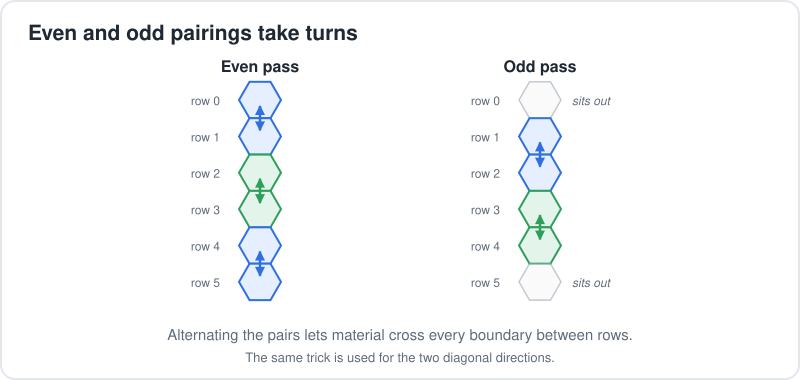

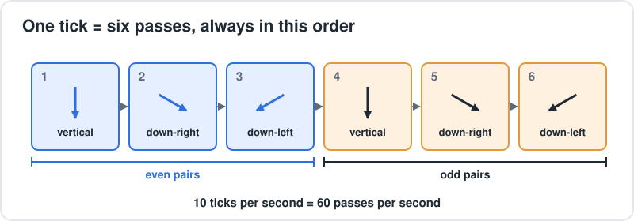

The backend has two banks of six render targets. Each scheduled pass reads the
previous pass's output, and alternating banks protect the textures still used for
presentation.

The scheduler accrues 60 passes per active gameplay second, which corresponds to
ten complete six-pass ticks per second. A fast presentation frame may have no
simulation work due. A slower frame can submit several ordered passes together,
up to the end of the current tick. Terrain speed therefore follows elapsed
gameplay time rather than the number of frames drawn.

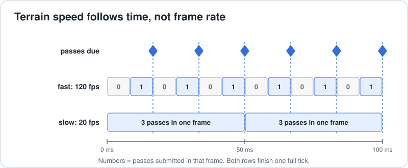

Before a run begins, the generated map also settles for 50 complete ticks.
Water, sand, and gases can move into place before the player enters.

## Keeping displaced material inside a cell

Consider sand falling into water. The sand needs to occupy the destination, but
the water needs somewhere to go. Deleting it would make material disappear
whenever something denser arrived.

The secondary component provides temporary storage. As sand displaces water,
sand becomes the denser primary material and displaced water can remain in the cell
as secondary content. It becomes invisible, but its quantity is still tracked.

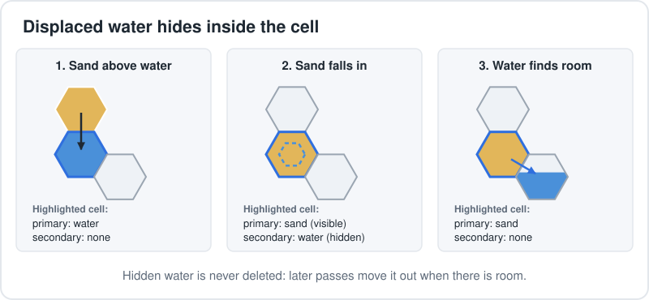

Later pair passes try to move that secondary water into compatible neighboring
capacity. If it is trapped, pressure can redistribute into full cells of the same
material, within the packed quantity limit.

After resolving a pair, the shader normalizes both cells: it removes empty
components, merges matching materials, promotes a surviving secondary component when
the primary empties, and orders different components by density. Hidden water
can therefore become visible again when the sand moves away.

This hidden content is stored inside the cell's four bytes. It is separate from
the intermediate render textures used to calculate successive passes.

Only the primary component affects rendering, collision, hazards, viscosity, and
item contact. A secondary component is simulation storage, so hidden lava does
not apply a second invisible contact hazard alongside the visible material.

There are limits to this representation. A cell can hold two material types, and
its quantities have a finite capacity. Rules must respect those limits.
Boiling, for example, waits when the cell has no component capacity for the expanded
steam.

Transport preserves component quantities. Reactions, explosions, and gas
escaping through the open top of the map are explicit transformations, sources, or
sinks.

## How the materials interact

The materials share movement rules driven by their definitions. Density
determines displacement priority, while transfer rates and pressure settings control how
quickly and where content moves. Water flows readily; lava behaves as a slower,
more viscous liquid. Light gases use an inverted form of the liquid rules to
rise and spread beneath ceilings.

Contact reactions add the changes that make those flows interesting. These are
authored gameplay rules rather than a chemical model.

### Water, lava, and steam

Once per tick, a water cell checks whether it touches lava. Contact converts
water into steam at the configured rate, with one water quantity producing ten
steam quantity in the default setup. Checking once per cell prevents water
surrounded by several lava cells from boiling several times as quickly.

The expansion makes available storage important. Steam needs space inside the
cell before it can spread outward.

Reacting lava has a 2% chance per tick to become a full stone hex. Sustained
contact can build a crust that separates the remaining water from the heat source.

Steam rises through air and spreads beneath ceilings. Overpressure lets it push
into other available space; downward movement requires its higher exits to be
blocked. Steam reaching the top row can vent out of the world.

Under stone or dirt, steam has a 10% chance per tick to condense. A successful
reaction consumes ten steam quantity and leaves one water quantity, which can
drip back down. A smaller remaining amount of steam disappears without producing
water.

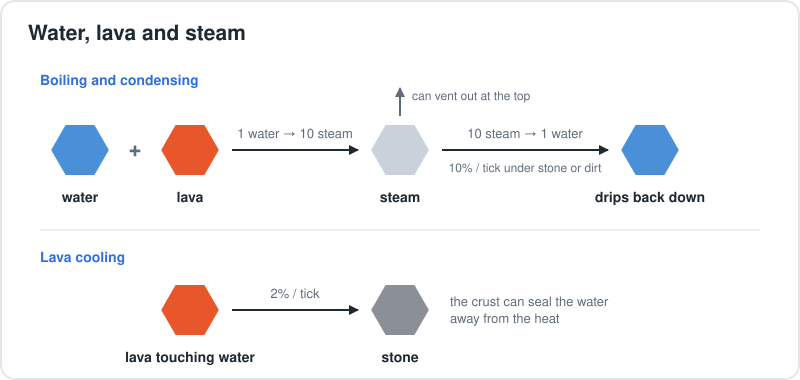

These chance reactions use integer hashes of the run seed, tick, cell position,
and a salt. The same simulation inputs produce the same reaction decisions.

### Sulfur, acid, and poisonous gas

Sulfur adds two different routes through the system.

Water touching sulfur gradually consumes sulfur and converts water into sulfuric
acid. The resulting dense liquid can sink beneath water. Acid also consumes
sand below it and becomes water, so a reaction can alter both a hazard pocket and
the ground containing it.

Lava ignites sulfur. Once ignited, the sulfur continues burning and producing
sulfur dioxide after the initial contact ends.

The burning state uses the same secondary component mechanism: burning sulfur
retains a small sulfur dioxide token as its ignition marker. Subsequent updates
consume sulfur and produce more gas.

Sulfur dioxide behaves as a heavy gas. It settles through air, while
overpressure can drive it upward. It also blocks breathing and builds the player's poison
meter. Steam remains breathable but contributes heat damage. Material identity
therefore connects the simulation to distinct player hazards.

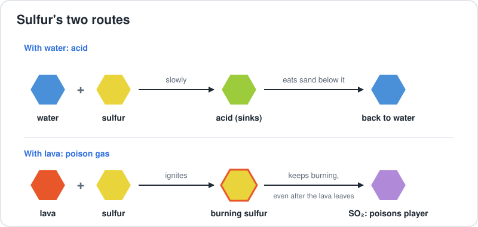

The interaction matters when terrain changes. Opening a wall can redirect water
toward sulfur, release a trapped gas pocket, or let lava reach a mineral
deposit. Those outcomes follow from the cells and their local rules.

## Drawing the cave with one quad

The terrain presenter draws one quad covering the world. Its fragment shader
converts each fragment's world position into a hex coordinate and a position inside
that hex.

From there it samples the world data and the material lookup textures. The
shader determines the visible material, partial fill, boundary shape, outline, and
lighting. Material artwork comes from an atlas, while additional shader effects
animate liquid surfaces.

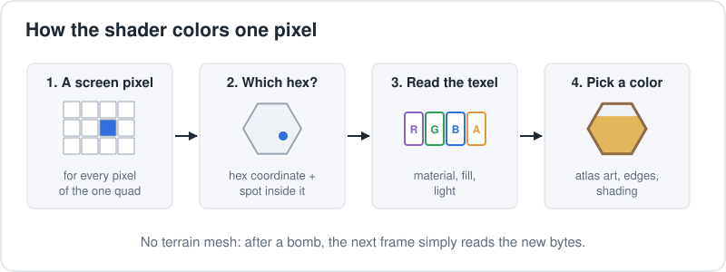

This separates simulation resolution from display resolution. A single
simulation texel can become a large, textured hex on screen.

The presenter samples the completed GPU simulation texture directly. It also
retains the completed even phase for a specific visual purpose: drawing verified
vertical trails through cells that are air in the final state. Falling liquids
retain their fluid appearance, and falling sand retains its solid material.

Lighting occupies the world texture's `B` channel. Simulation passes propagate
light from terrain and external sources, while the presentation shader turns that
value into cave darkness and visible material brightness. Retained exploration
values also support fog of war.

Bombing a wall changes cell data. The next presentation uses those changed cells
without generating new terrain polygons. The terrain itself remains one quad
and one shader material; players, items, backgrounds, and effects have their own
rendering.

## Colliding with the committed world

The player still needs solid ground, wall contacts, and reliable landings. Those
checks operate on a CPU copy of the completed terrain state.

At the end of a six-pass tick, the backend reads the final render texture back
into WorldGrid's packed byte buffer. Gameplay collision reads this committed
snapshot while rendering continues to use the GPU texture.

The data flow is: committed CPU cells -> GPU simulation passes -> completed GPU
texture -> terrain presentation shader. After each complete tick, readback updates
the CPU cells used by collision and gameplay queries.

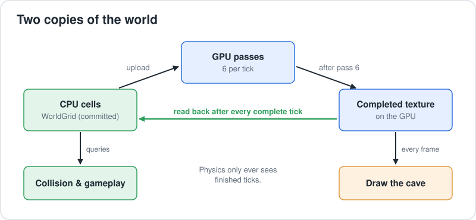

TerrainCollisionQuery converts a body's position into a small range of nearby
candidate cells. It checks material solidity and quantity, then performs geometric
tests against the corresponding hex polygons.

Those polygons are calculated for the query. They are not stored as a terrain
physics mesh or registered as thousands of collider objects.

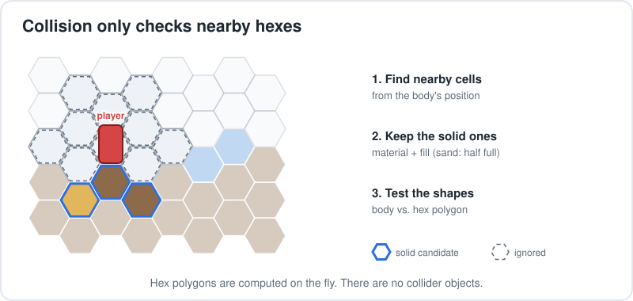

The movement solver uses the contacts to resolve motion, floor support, and
stepping over low terrain. Related queries handle circular and convex polygon
bodies, so terrain-aware objects can use the same committed world.

Quantity matters here too. Sand becomes solid at half fill, according to its
configured rule. Liquids remain passable and apply drag through separate fill-aware
sampling.

Player physics runs independently of the terrain commit cadence. It keeps
resolving movement against the latest completed snapshot while another simulation tick
is being calculated.

## Making explosions and simulation agree

Explosions introduce another writer. They change the CPU world immediately,
potentially while the GPU is partway through a tick.

Allowing that unfinished tick to commit would risk replacing the explosion's
changes with a result calculated from older terrain.

Gameplay mutations therefore publish an exact set of changed cells. The backend
cancels unfinished simulation work, uploads the patched world state, and
restarts from it. Stale render callbacks are invalidated so abandoned work cannot
publish a later result.

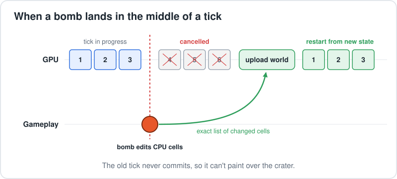

This gives gameplay mutations a clear priority while keeping partially simulated
states out of collision queries. The player, item code, and terrain shader all
consume completed states.

## The costs of this architecture

The approach keeps scene complexity independent of cell count. A larger map adds
texture data and simulation work without adding a Node or physics collider for
every hex.

It still has costs. Each simulation pass processes the world texture. Reading
the completed texture back to the CPU introduces synchronization and transfer
work. The presentation shader spends GPU time on material sampling, boundaries,
lighting, and fluid effects. One terrain draw call does not make that fragment work
free.

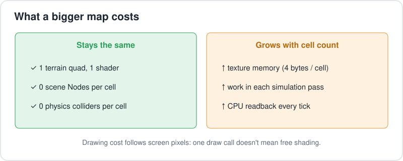

The cell format also shapes the rules: four-bit material IDs, two components per
cell, and byte-sized quantities are deliberate limits. The hidden component
helps conserve displaced content within that compact representation, but it cannot
hold an arbitrary mixture.

For Claim Earth, the useful result is a common representation across systems. A
bomb changes a few bytes, local rules carry the consequences through the cave,
the shader draws the new terrain, and collision queries give it physical meaning.

That is what lets a small opening become a stream, a steam pocket, or a new
route down.

---

Originally published on [itch.io](https://titan-koyos.itch.io/claim-earth/devlog/1799603/claim-earth-simulating-rendering-and-colliding-with-a-texture).
